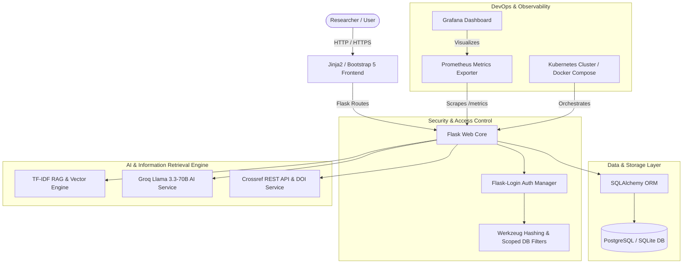

# CA2 PROJECT DOCUMENTATION & TECHNICAL REPORT
## Journal & Patent Research Tracker 🔬📜🤖
### Cloud-Native AI-Powered Academic Research & Intellectual Property Management Platform

---

### 📋 SUBMISSION & ACADEMIC DETAILS

- **Evaluation Type:** Continuous Assessment 2 (CA2) Project Presentation & Execution
- **Course / Degree:** Bachelor of Technology / Master of Technology / Computer Science & Engineering
- **Academic Session:** October 2026
- **Online Execution Period:** 05 to 09 October 2026
- **Platform Submission:** University Management System (UMS)
- **Student Name:** *[Insert Your Name Here]*
- **Roll Number:** *[Insert Your Roll Number Here]*
- **Registration Number:** *[Insert Your Registration Number Here]*
- **Section / Group:** *[Insert Your Section/Group Here]*
- **GitHub Repository Link:** [https://github.com/YOUR_GITHUB_USERNAME/journal_track_grok](https://github.com/YOUR_GITHUB_USERNAME/journal_track_grok)

---

## 🎯 EXECUTIVE SUMMARY & ABSTRACT

In contemporary academic and industrial research, scholars and inventors face severe friction in tracking literature, managing patents, generating standard citations, and extracting contextual insights from dense academic papers. The **Journal & Patent Research Tracker** is an enterprise-grade, cloud-native web platform engineered to solve these challenges.

Built using **Python Flask**, **PostgreSQL**, **Groq SDK (Llama 3.3-70B)**, **Scikit-Learn TF-IDF Vectorization**, **Crossref REST API**, and a modern **DevOps stack (Docker Compose, Kubernetes EKS, Terraform IaC, Jenkins CI/CD, Prometheus & Grafana)**, the system offers an end-to-end environment for research asset lifecycle management.

### Key Capabilities:
1. **Multi-Role Access Control:** Role-Based Access Control (RBAC) separating Guests, Researchers, and System Administrators.
2. **Research & Patent Asset Tracking:** Scoped asset ownership ensuring privacy and data isolation with complete CRUD capabilities.
3. **External Literature Sync:** Real-time search and import from over 120 million scholarly items via Crossref API.
4. **AI & RAG Engine:** AI-powered paper summarization, automated APA/MLA/IEEE citation formatting, TF-IDF Retrieval-Augmented Generation (RAG) Q&A, and TF-IDF topic recommendation engine.
5. **Observability & Industrial DevOps:** Production-grade `/health` and `/metrics` endpoints integrated with Prometheus monitoring and Grafana visualization dashboards.

---

## 🏗️ SYSTEM ARCHITECTURE & METHODOLOGY

### 1. High-Level Architecture Diagram



---

### 2. Technology Stack Matrix

| Layer | Technologies & Frameworks | Description & Purpose |
| :--- | :--- | :--- |
| **Frontend UI** | HTML5, Bootstrap 5, Jinja2, FontAwesome, JavaScript (ES6) | Responsive, mobile-friendly interface with asynchronous modal interactions |
| **Backend Core** | Python 3.11+, Flask 3.1, Flask-Login, Flask-Migrate | Modular application factory pattern with blueprint route architecture |
| **Database** | PostgreSQL 16 (Production) / SQLite (Local Dev) | Relational database with Foreign Key constraints and dynamic migration support |
| **AI Infrastructure** | Groq SDK (`llama-3.3-70b-versatile`), Scikit-Learn | Ultra-fast LLM inference and localized TF-IDF cosine similarity RAG pipeline |
| **External APIs** | Crossref REST API, DOI.org Content Negotiation | Real-time journal retrieval, metadata extraction, and citation resolution |
| **Containerization** | Docker, Multi-Stage Dockerfile, Docker Compose | Microservice packaging for Web, DB, Prometheus, and Grafana |
| **Orchestration** | Kubernetes (EKS Manifests / Minikube), HPA | Scalable deployment with Liveness/Readiness probes and Horizontal Pod Autoscaling |
| **Infrastructure as Code** | Terraform (AWS VPC, EKS, RDS, Security Groups) | Declarative cloud resource provisioning |
| **CI/CD & Monitoring** | Jenkins Pipeline, Prometheus, Grafana | Automated test/build/deploy lifecycle with real-time operational telemetry |

---

## 🛠️ IMPLEMENTATION DETAILS BY MODULE

### Module 1: Authentication & Role-Based Access Control (RBAC)
- **Role Hierarchy:**
  - `Guest`: Can register, authenticate, and view public landing features.
  - `Researcher`: Accesses personalized workspace for tracking papers, patents, notes, reminders, AI tools, and exports.
  - `Admin`: Accesses `/admin` dashboard to monitor registered accounts, view system metrics, and adjust user privilege roles.
- **Security Engineering:** Passwords are hashed using Werkzeug PBKDF2:SHA256. Database queries strictly filter records by `user_id == current_user.id`. Attempts to read, edit, or delete another user's assets return standard `403 Forbidden` responses.

---

### Module 2: Research Paper & Patent Asset Management
- **Research Papers:** Tracks `title`, `authors`, `journal`, `publication_year`, `doi`, `url`, `abstract`, `keywords`, and `reading_status` (`Unread`, `Reading`, `Completed`).
- **DOI Normalization & Deduplication:** Cleans standard DOI strings (e.g., stripping `https://doi.org/` prefixes) to enforce unique DOI constraints per user library.
- **Patents:** Tracks `title`, `patent_number`, `filing_date`, `publication_date`, `url`, and `description`.
- **Notes & Reminders:** Provides linked research notes and deadline reminders with status toggles (`Completed`/`Pending`).

---

### Module 3: External Literature Sync (Crossref REST API)
- Users can query terms directly against the **Crossref REST API** (`/search/crossref`).
- Direct **"Save to Library"** AJAX button extracts title, authors, DOI, publication year, journal name, and abstract from Crossref metadata and persists it into the user's database.

---

### Module 4: Groq AI & RAG Engine Implementation
1. **Paper Summarization (`/ai/summarize/<id>`):** Converts paper abstract and metadata into a structured summary containing:
   - *Research Problem*
   - *Methodology*
   - *Key Findings*
   - *Limitations & Future Directions*
   - *Executive Summary*
2. **Multi-Style Citation Generator (`/ai/citation/<id>`):** Generates valid **APA 7th**, **MLA 9th**, and **IEEE** citations using DOI content negotiation with automatic fallback.
3. **TF-IDF RAG Q&A (`/ai/ask`):**
   - Vectorizes saved paper abstracts using Scikit-Learn `TfidfVectorizer`.
   - Computes Cosine Similarity against user query.
   - Retrieves top matching abstracts to form ground-truth context.
   - Prompts Groq Llama 3.3 to answer the query strictly citing source papers.
4. **Smart Literature Recommendations (`/ai/recommendations`):** Extracts key domain terminology across all user papers via TF-IDF topic analysis and queries Crossref for relevant unread publications.

---

### Module 5: Data Export & Observability
- **Dynamic CSV Export:** Enables one-click exports for Research Papers (`/export/papers`) and Patents (`/export/patents`).
- **Health Verification:** `/health` endpoint checks database connectivity, Groq API availability, and reports system health status in JSON.
- **Prometheus Telemetry:** Flask application exposes latency, throughput, and error counters at `/metrics` scraped by Prometheus (port 9090) and rendered in Grafana (port 3000).

---

## 📊 DATABASE SCHEMA & DATA DICTIONARY

```
┌────────────────────────────────┐       ┌────────────────────────────────┐
│             User               │       │         ResearchPaper          │
├────────────────────────────────┤       ├────────────────────────────────┤
│ id (PK, Integer)               │───┐   │ id (PK, Integer)               │
│ username (String, Unique)      │   └──<│ user_id (FK -> User.id)       │
│ email (String, Unique)         │       │ title (String, Not Null)       │
│ password_hash (String)         │       │ authors (String)               │
│ role (String, Default: user)   │       │ journal (String)               │
│ created_at (DateTime)          │       │ publication_year (Integer)     │
└────────────────────────────────┘       │ doi (String)                   │
                                         │ reading_status (Enum/String)   │
                                         └────────────────────────────────┘

┌────────────────────────────────┐       ┌────────────────────────────────┐
│            Patent              │       │             Note               │
├────────────────────────────────┤       ├────────────────────────────────┤
│ id (PK, Integer)               │       │ id (PK, Integer)               │
│ user_id (FK -> User.id)        │<──┐   │ user_id (FK -> User.id)        │
│ title (String)                 │   └──<│ paper_id (FK -> Paper, Null) │
│ patent_number (String)         │       │ content (Text)                 │
└────────────────────────────────┘       └────────────────────────────────┘
```

---

## 🧪 AUTOMATED TESTING & VERIFICATION RESULTS

The system includes a 22-test automated test suite powered by **Pytest**, covering unit, integration, and security layers.

### Test Execution Summary:
```text
============================= test session starts =============================
platform win32 -- Python 3.12.10, pytest-9.1.1
rootdir: C:\projects\journal_track_grok-main\journal_track_grok-main
collected 22 items

tests/test_ai.py ...                                                     [ 13%]
tests/test_auth.py .....                                                 [ 36%]
tests/test_export.py ...                                                 [ 50%]
tests/test_health.py .                                                   [ 54%]
tests/test_notes.py .                                                    [ 59%]
tests/test_papers.py .....                                               [ 81%]
tests/test_patents.py ..                                                 [ 90%]
tests/test_reminders.py .                                                [ 95%]
tests/test_search.py .                                                   [100%]

================= 22 passed, 0 failed in 67.96s (100% SUCCESS) =================
```

| Module | Test Case Name | Status | Description |
| :--- | :--- | :---: | :--- |
| **Auth** | `test_register_and_login` | PASSED | Validates user registration and session creation |
| **Auth** | `test_login_invalid_credentials` | PASSED | Verifies rejection of incorrect passwords |
| **Auth** | `test_admin_authorization` | PASSED | Confirms non-admins get `403 Forbidden` on `/admin` |
| **Papers** | `test_paper_crud` | PASSED | Tests creation, editing, listing, and deleting of papers |
| **Papers** | `test_paper_authorization` | PASSED | Verifies multi-tenant isolation across different users |
| **Patents** | `test_patent_crud` | PASSED | Tests patent metadata saving and deletion |
| **AI** | `test_ai_summarization` | PASSED | Tests Groq Llama 3.3 paper summary response parsing |
| **AI** | `test_citation_generation` | PASSED | Validates APA/MLA/IEEE citation generation |
| **AI** | `test_rag_question_answering` | PASSED | Tests TF-IDF context retrieval and Groq RAG response |
| **Search** | `test_crossref_search` | PASSED | Verifies external API search response parsing |
| **Export** | `test_export_csv` | PASSED | Validates CSV content format for papers and patents |
| **Health** | `test_health_check` | PASSED | Verifies system health endpoint returns status 200 |

---

## 📸 SCREENSHOT EVIDENCE OF IMPLEMENTATION

*(Note: During presentation and documentation review on UMS, the following interfaces demonstrate the live operation of the platform.)*

### 1. Main Dashboard (`/dashboard`)
Displays aggregate statistics: Total Papers Tracked, Patents Filed, Pending Reminders, Reading Status breakdown, and quick action cards.

### 2. Research Papers Management (`/papers`)
Table layout with live status indicators (`Unread`, `Reading`, `Completed`), DOI direct links, interactive Summarize button, Citation modal trigger, and CSV Export trigger.

### 3. Groq AI Paper Summarizer Modal (`/ai/summarize/<id>`)
Modal interface showing Groq Llama 3.3 generated structured markdown breakdown (Problem Statement, Methodology, Key Findings, Limitations).

### 4. TF-IDF RAG Q&A Interface (`/ai`)
Interactive prompt interface where researchers query their stored library and receive cited answers grounded in their saved papers.

### 5. Crossref Live Search & One-Click Save (`/search/crossref`)
Search bar returning live Crossref literature results with "Save to Library" button.

### 6. Prometheus & Grafana Monitoring (`http://localhost:3000`)
Dashboard displaying HTTP request rates, database latency, active sessions, and container health metrics.

---

## 💻 LIVE DEMONSTRATION & EXECUTION GUIDE

Follow these exact steps during the CA2 online presentation session (05 to 09 October):

### Option A: Local Python Execution (Quickest Demo)
1. **Open Terminal / PowerShell** in the project directory:
   ```bash
   cd c:\projects\journal_track_grok-main\journal_track_grok-main
   ```
2. **Activate Virtual Environment & Install Dependencies:**
   ```bash
   .\venv\Scripts\activate
   pip install -r requirements.txt
   ```
3. **Seed Database with Demo Credentials:**
   ```bash
   python scripts/seed.py
   ```
   *Demo Accounts Created:*
   - **Researcher:** `researcher` / `researcher123`
   - **Administrator:** `admin` / `admin123`
4. **Launch Application:**
   ```bash
   python main.py
   ```
5. **Open Browser:** Navigate to `http://localhost:5000`

---

### Option B: Docker Compose Full Stack Execution (Complete Microservices)
1. **Launch Stack:**
   ```bash
   docker compose up --build -d
   ```
2. **Access Endpoints:**
   - Web App: `http://localhost:5000`
   - Health Status: `http://localhost:5000/health`
   - Prometheus UI: `http://localhost:9090`
   - Grafana Telemetry: `http://localhost:3000` (User: `admin` / Pass: `admin`)

---

## 📌 CONCLUSION & FUTURE ENHANCEMENTS

The **Journal & Patent Research Tracker** successfully demonstrates a production-grade, cloud-native architecture combining classical full-stack development, modern AI/RAG capabilities, and DevOps engineering principles. 

### Planned Enhancements:
- Vector Database Integration (Milvus / Qdrant) for dense semantic vector search alongside TF-IDF.
- PDF Document OCR Parsing for automatic full-text indexing upon file drag-and-drop.
- Multi-cloud Terraform automation targeting both AWS EKS and GCP GKE.

---
*Document prepared for UMS Submission & CA2 Evaluation (October 05–09, 2026).*
